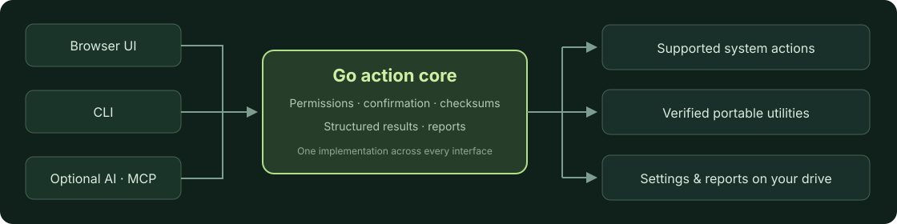
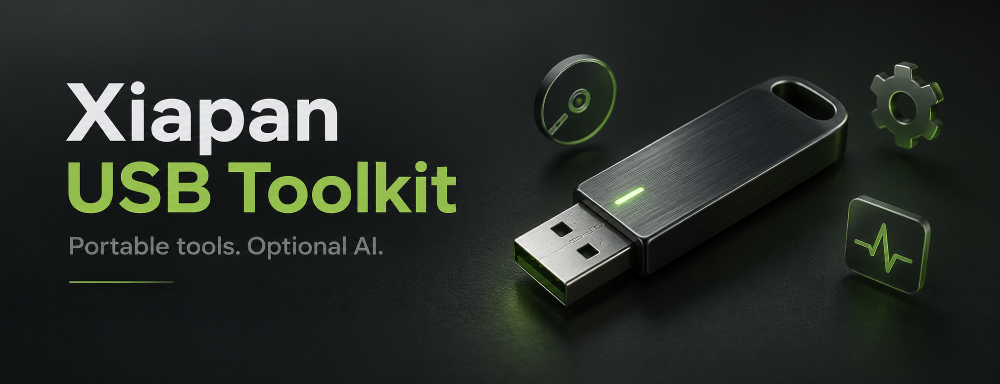

<p align="center">
  
</p>

<p align="center"><a href="README.md">English</a> · <a href="README.zh-CN.md">简体中文</a> · <a href="README.ja.md">日本語</a></p>

# U-PicoClaw · Xiapan USB

**A portable AI USB drive: a lightweight interface, your wallet and API key, local program caching, and emergency maintenance tools.**


[Quick start](#quick-start) · [Platforms](#platforms) · [Build a USB package](#build-a-portable-usb-package) · [Contribute](CONTRIBUTING.md)

> [!NOTE]
> **Preview release.** The package recipe includes Windows x64 and macOS Apple Silicon / Intel binaries. The new macOS package has not passed physical-device acceptance; the remote test host was unavailable. Windows maintenance tools are not Mac tools. See [product scope](docs/PRODUCT.md) for the release boundary.

## Your AI, on your drive

Start in the existing lightweight interface. For longer tasks, skills, channels and detailed configuration, open **Full PicoClaw** from that same page. Both interfaces use the managed persistent Gateway; closing a browser page does not stop it. Use **Quit** before safely ejecting the drive.

| Capability | What you get |
| --- | --- |
| Portable wallet and API key | Use Xiapan Cloud or your own compatible API. Credentials, settings and conversations stay on the drive. Opening the home page does not create a wallet. |
| Top up when needed | Open the wallet, view the balance and open the payment page. Payment remains a user action. |
| Local program cache | Verified PicoClaw executables can run from this computer’s cache, reducing repeated USB reads. Keys, wallet and work are not moved into that cache. |
| Offline emergency tools | Inspect the computer and open compatible maintenance tools without a model, API key or wallet balance. |
| Computer maintenance toolkit | 9 portable utilities + 9 Windows system entries; 5 native system entries on Mac. |
| Your language | Switch the interface between Chinese and English; the preference travels with the drive. |

The first cache fill still reads the USB drive. Home-page readiness, Gateway startup and the first model response are separate measurements; **0.3-second startup is not a verified product guarantee**. Package size depends on the selected platform binaries and tool resources. This product bundles no local-model weights or inference runtime and does not include OpenClaw.

## Interface language

The language selector in the top bar switches every application-owned label between **简体中文** and **English**. It saves to `data/settings/ui.json` on the drive, so the choice follows you to the next computer, and it also tells the AI which language to answer in.

Chat text, file paths, raw JSON evidence and your own session titles are never translated — only the interface itself. If the language resource fails to load, the interface stays in Chinese rather than breaking.

## Sidebar

The navigation sidebar is visible by default, with a toggle to collapse it into a narrow icon rail. The collapsed state is remembered in the browser. Below 780px the sidebar becomes an overlay drawer that the **History** button opens, so the content is never squeezed on a small screen.

## Quick start

Install **Git and Go 1.24+**, then build the core from the same repository on Windows, macOS or Linux:

```sh
git clone --branch codex/u-picoclaw-portable https://github.com/dongsheng123132/xiapan-usb.git
cd xiapan-usb
go test ./...
go build -o dist/xiapan .
./dist/xiapan action run system.inspect --json --no-input
```

On Windows, use `go build -o dist/xiapan.exe .` and `./dist/xiapan.exe` instead. The built core does not automatically include PicoClaw or third-party tools. See the [development guide (Chinese)](docs/DEVELOPMENT.md) for platform work and contribution branches.

## The toolbox

The Windows release recipe contains **9 portable utilities and 9 system-tool entries**, plus clearly marked optional download resources. The catalog shows actual availability for the current platform; counts are not a claim that every optional tool is installed.

| Adapted utility | Purpose |
| --- | --- |
| WinDirStat | Understand disk usage |
| PeaZip | Create and extract archives |
| Everything | Find files quickly |
| Explorer++ | Browse and manage files |
| Notepad++ | Edit text and configuration files |
| SumatraPDF | Read PDF documents |
| CrystalDiskInfo | Inspect drive health and SMART information |
| PhotoRec | Recover files to a separate healthy destination |
| TestDisk | Inspect partition and recovery options |

Pinned manifests record tool files, hashes, versions and licenses. The build uses only the approved immutable files from a resource source. Driver resources and hardware identification are provided separately: automatic driver matching, installation and rollback are not implemented. Windows system tools include Task Manager, Device Manager and other OS-provided utilities.

On Mac, the toolkit opens **Activity Monitor, Disk Utility, Console, System Information and Wireless Diagnostics** when present. These are macOS-provided applications, not bundled Windows utilities; real Mac launch acceptance is still pending. The toolkit and quick-start instructions are available in Chinese and English. Third-party utility interfaces keep their upstream language support.

Copy all contents of a fresh master folder to the USB drive, preserving the folders. Start with `Start Windows.cmd` or `Start Mac.command`. Read the [English quick start](docs/QUICKSTART.en.md) or [中文快速入门](docs/QUICKSTART.zh-CN.md), including custom API setup for Kimi, Zhipu and Gemini. Model settings require a compatible base URL, key and tool-capable model ID; Gemini's advanced tool tasks should use the native provider in Full PicoClaw.

## One PicoClaw runtime, two interfaces

| Entry | Purpose |
| --- | --- |
| Lightweight home page | Quick conversation, model settings, wallet and maintenance shortcuts. |
| Full PicoClaw | Start the official workbench on demand for advanced interaction and configuration. |
| Maintenance guide | Deterministic inspections and tool launch without AI or network credit. |

The core and official launcher are frozen to **PicoClaw v0.3.1**, with distribution patches that disable self-update. The manifest locks both executables by SHA-256. Customer drives do not track upstream latest or nightly releases.

PicoClaw’s tool features are enabled under the current user’s OS permissions. GUI, CLI and maintenance MCP reuse the maintenance action core. The confirmation rules of maintenance actions do not constrain arbitrary shell commands available through PicoClaw.



## Platforms

| Platform | Verified scope |
| --- | --- |
| **Windows x64** | Previous USB maintenance flows were tested on physical drives. The 0.5 Gateway/cache package needs its own recorded release checks; older tests do not prove the new package. |
| macOS · Apple Silicon / Intel | Both platform binaries are part of the package recipe. Hardware acceptance, first-run trust, permissions and USB behavior remain unverified; the remote Mac test host was unavailable. |
| Linux x64 | Core source/build target only; not included in this three-platform product package. Previous WSL inspection/report tests do not establish a Linux desktop release. |

Several platform binaries can share one drive, but each OS runs its own executable. **This is not currently a bootable rescue OS** and cannot run inside a computer whose operating system will not start. Startup inspection covers common Run entries and startup folders, not every service or scheduled task; it does not disable entries automatically.

## Build a portable USB package

Maintainers need Go, PowerShell and Python 3.11+. Rebuilding the frozen official workbench additionally needs Node.js and pnpm. End users need none of those build tools.

```powershell
python scripts/build-picoclaw-pinned.py
.\scripts\build.ps1
python scripts/package-portable.py --resources "D:\verified-tool-resources" --output "D:\release\U-PicoClaw-0.5.3-portable-preview"
```

The resource path must contain the approved tool files. The output must be a new directory. The packager validates hashes, creates a clean data directory and writes release checksums; it does not copy the source drive’s personal data. Use this recipe instead of the historical package-genie script. See the [development guide](docs/DEVELOPMENT.md) for prerequisites and acceptance checks.

```text
虾盘.exe   Windows entry
app/       Platform executables, frozen PicoClaw, tools and licenses
data/      Personal settings, wallet, conversations and work
drivers/   Prepared driver resources
```

> [!IMPORTANT]
> API keys and their backups are currently stored **in plaintext on the drive**. Keep the drive private. Moving it to another PC still requires a reachable provider and a valid key; a localhost model server must run on that PC. A maintainer-tested future release must preserve `data/` and each tool's personal configuration; customer drives do not self-update. Never ship a used data directory to another customer.

## Open source, with optional preloaded drives

Our source is [MIT licensed](LICENSE). Download it and build your own drive, or choose a preloaded physical drive when available. Hardware, prepared maintenance resources, verified setup and support are the service being sold. Cloud credit is optional and does not unlock basic local maintenance.

Third-party software retains its own license. Read [third-party notices](THIRD_PARTY.md) and the [distribution guide (Chinese)](docs/DISTRIBUTION.md) before redistributing a package.

<details>
<summary>Project artwork</summary>



Concept artwork, not a photograph of a shipping device. [Design notes and tooling](docs/README-DESIGN.md).

</details>

## Help build it

Platform adapters, reproducible bug reports and portable-tool recipes are welcome. Start with [Contributing](CONTRIBUTING.md), [Security](SECURITY.md) or [open an issue](https://github.com/dongsheng123132/xiapan-usb/issues). Do not post wallet links, API keys or private diagnostics.

[Xiapan Cloud](https://cloud.u-claw.org/) · [U-King](https://www.u-king.org/) · [Xiapan Canvas](https://tu.u-claw.org.cn/)
