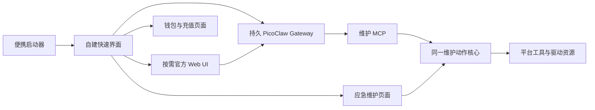

# 虾盘随身 AI Lite（U-PicoClaw）：产品边界与便携架构

更新：2026-10-13。本文是本仓库产品范围的唯一说明；发行说明引用本文，不另设产品路线。

**状态：按用户最新决定保留自建快速界面，官方界面按需打开，共用持久 Gateway。** 实现与发行证据另见发布验证记录；Mac 交叉构建不等同于 Mac 实机验收。

## 1. 产品定位

**换台电脑，接着干。** 虾盘随身 AI Lite 把自己的 AI 配置、会话、记忆、技能和盘内工作带到下一台电脑，是可以读文件、写文件、调用工具执行任务的便携办公搭子。

2026 年 10 月，AI 工具已经很多，仍值得解决的是使用环境的连续性：到了办公室、家里或一台陌生电脑，常用配置和工作上下文不在；电脑出问题时，还需要能直接打开的诊断与维护工具。产品价值围绕这两个具体场景展开。**随身 AI、钱包随盘、程序缓存、断网应急、电脑维护工具包**是实现这一价值的五个部分。该形态是否长期成立，取决于跨电脑使用和应急需求是否持续，而不是把“市场会一直存在”作为已验证结论。

### 产品家族

| 产品 | 定位与引擎 | 本仓库责任 |
| --- | --- | --- |
| 随身 AI Lite / U-PicoClaw | PicoClaw 便携版；轻量入口、日常任务、钱包与维护工具 | 本文及本仓的实现、发行和验收范围 |
| 随身 AI Pro / U-Claw | 既有的 OpenClaw 便携版；面向更完整的个人 AI 工作环境 | 品牌家族中的独立产品，能力以其自身版本和验收为准 |

Pro 不是 Lite 中尚未完成的开关，也不表示本次 Lite 母盘已经包含 OpenClaw。两者共享“个人 AI 环境随身带”的产品方向，不由本仓复制另一套引擎或发行逻辑。

### 优先使用场景

| 场景 | 用户要完成的事 | 可观察结果 |
| --- | --- | --- |
| 办公室 → 家里 → 临时电脑 | 带着配置、记忆、技能和任务资料继续工作 | 重新启动后找到已有会话与盘内资料，继续产出；同一实体盘两台真机的完整接续尚待验收 |
| 本地文件办公 | 读取一组资料，整理目录、汇总内容或生成工作文件 | 由当前用户授权的工具实际读取、写入文件，结果可在文件系统核对 |
| 电脑出现故障或网络异常 | 查看系统、进程、启动项、网络证据，打开合适工具 | 显示真实诊断结果和工具执行结果；打开工具不等于故障已修复 |
| 新手第一次使用云端 AI | 不研究 API Key 的申请、复制和配置 | 打开随盘钱包，完成充值到账后使用；仍可选择自己的兼容 API |

日常工作由 PicoClaw 连接用户选择的在线模型。AI 软件和工具在本机运行，不代表模型也在本机离线推理。无法联网时，用户直接使用确定性的诊断、维护流程和盘内工具；离线 AI 不是 Lite 的默认能力，本包不携带本地模型。

| 范围 | 决定 |
| --- | --- |
| AI 引擎 | 只做 PicoClaw 的便携化，开放其完整工具能力 |
| 首发平台 | Windows x64、macOS Apple Silicon、macOS Intel；同仓、同发行配方 |
| 随盘状态 | API Key、模型设置、会话、记忆、技能、盘内工作文件、钱包引用和维护记录 |
| 充值 | 虾盘云设备钱包免手填 API Key；一键打开付款页面，用户付款后刷新到账状态 |
| 断网应急 | 固定诊断/修复动作、传统维护工具、已验证的驱动资源 |
| 排除范围 | OpenClaw、其他 Agent/Harness 套装、自带本地模型权重和本地推理引擎 |
| Linux | 保留已有源码可移植性，首轮不承诺 Linux 成品盘 |

用户自行填写本机或局域网的兼容 API 地址仍属于自带 API；这不意味着本仓库维护 Ollama、llama.cpp 或模型下载/安装功能。

“即插即用”指首次设置服务后，换电脑无需重新安装应用和重新录入同一 API Key。macOS 首次信任与系统权限由目标电脑决定；不能把交叉编译等同于成品验证。

## 2. 保留快速界面，按需打开完整界面

**自建 Web UI 保留为默认入口；复杂任务、原生配置和渠道设置由“完整 PicoClaw”打开固定版本的官方 Web UI。两个入口共用一个持久 Gateway。**

首屏只需本机 HTTP 服务与内嵌静态资源，不等待系统盘点、云余额、模型或 Gateway 初始化。用户发送第一条 AI 消息或打开完整界面时，才验证/准备运行时并启动 Gateway。关闭浏览器不等于退出；页面“退出”负责停止本程序管理的进程。

官方 v0.3.1 的 `picoclaw-launcher` 是嵌入前端资源的 Go 程序，与 `picoclaw` 核心分别打包。最终用户无需 Node.js/Python。官方界面通过独立本机页面保留其本地认证；不使用 iframe，不关闭认证。

| 部分 | 维护责任 |
| --- | --- |
| 日常快速聊天、钱包、维护入口 | 保留本仓库轻量 Web UI |
| 原生复杂交互、模型/渠道/技能/工具设置 | 固定官方 Web UI |
| 推理、工具、子代理、定时、原生会话 | 同一个 PicoClaw Gateway |
| 启动、盘根、进程清理、固定产物与缓存 | 本仓库便携层 |
| 余额、充值、凭证导入/轮换 | 本仓库设备钱包模块 |
| 诊断、工具和驱动库存 | GUI、CLI、MCP 共用维护动作核心 |

两套界面不建立两套 Agent。自建界面的聊天记录用于恢复其对话展示，原生执行会话仍由 Gateway 保存；不能宣称两套聊天界面的历史列表完全相同。配置桥接只维护自建界面拥有的 provider 条目，不覆盖官方界面新增的其它模型、渠道或工具配置。

上游源码按固定 tag/源码校验取得，只维护少量发行补丁。官方界面按需启动，保持默认启动路径轻量。

## 3. 四个模块足够



1. **便携层**：定位盘根与平台，检查资源，准备本次运行路径，启动/停止自己管理的进程。首页不等待余额查询、远程版本查询或模型请求。
2. **PicoClaw 层**：便携层管理一个持久 Gateway，官方 launcher 挂接该实例。定时、子代理和原生会话复用上游；不另建第二套调度器。
3. **钱包层**：保留现有钱包能力，不另造聊天引擎。自带 API 不要求创建钱包；仅浏览首页不自动开户。查询失败显示未知而非零余额。
4. **维护层**：离线独立运行，以稳定 Action ID 暴露确定性动作。诊断证据、执行结果和报告无需模型参与。

发行装配使用同一份平台/资源清单，是上述模块的构建出口，不作为另一个业务系统。

## 4. 状态所有权与跨设备

“接着干”指**已保存的任务上下文与工作文件接续**：保存结果 → 在界面退出 → 安全移除 U 盘 → 换电脑启动 → 读取已有状态继续任务。它不是进程迁移，不保证下载、运行中的命令、未结束的模型请求或后台任务跨电脑不停机。不得把运行中直接拔盘作为演示步骤。

只有保存在盘内的工作资料会跟着走。本机桌面、下载目录和其它硬盘上的文件，须由用户选定后复制或整理进盘内工作区，才属于随盘任务；现有绝对路径引用、外部账号登录和第三方 CLI/MCP 的依赖也不会自动变成可迁移状态。目前未完成同一实体盘在两台真机之间接续会话、技能和文件产出的整体验收，同机换目录或双盘测试不能替代它。

目标盘结构沿用现有 `app/`、`data/`、`drivers/`，避免为每个平台复制一份产品：

```text
盘根/
  Windows 启动入口
  Mac 启动入口
  app/
    bin/                         本仓库各平台启动/维护程序
    runtime/picoclaw/<平台>/      固定的 core 与 launcher
    tools/<平台>/                已验证传统工具及许可材料
  drivers/<平台>/                驱动资源与索引
  data/
    pico/                    原生配置、凭证、launcher 状态
      workspace/                 原生会话、记忆、用户技能与工作文件
    wallet/                      钱包身份与余额引用
    chat/                        自建界面对话展示记录
    reports/                     维护报告
    settings/                    界面与模型设置
```

- 启动时按当前盘根设置 `PICOCLAW_HOME`、`PICOCLAW_CONFIG`、`PICOCLAW_BINARY`、`PICOCLAW_AGENTS_DEFAULTS_WORKSPACE`。上游不使用本仓库的 `--root` 参数。
- 不把旧盘符或 `/Volumes/旧卷名` 固化为新机器的工作目录。自己生成的路径每次启动解析；用户配置的外部路径缺失时明确报告，不猜测替换。
- 自建界面模型选择以 `data/settings/model.json` 为输入，钱包以 `data/wallet/device.json` 为凭证真相源；一个适配器把它们同步到原生配置中的本产品 provider 条目。其它原生 provider/渠道/工具以 PicoClaw 配置为真相源。指纹未变时保留官方界面编辑，避免每条消息重复覆写。
- 钱包身份仍由钱包模块管理。将虾盘云接入原生 provider 的桥接逻辑集中在一个适配器中；写入原生配置时保留用户自建 provider，仅更新本模块拥有的记录，禁止每轮重写全部配置。
- 出厂工具与用户工具设置分开；迁移现有 `app/tools/` 内个人设置时必须保留原件。仅设置 PicoClaw 的 home 不能保证任意外部 CLI/MCP 的状态也随盘，扩展逐项验收。
- 用户 API Key 需要跨设备可读，不能默认采用绑定某台 Windows/macOS 的加密方案。若后续提供加密备份，使用用户持有的跨平台口令方案。发行模板始终不含个人 Key、钱包或工作文件。
- 运行实例只监听本机地址，保留上游本地认证；不为减少点击而开放未经认证的局域网入口。

## 5. 版本冻结与完整功能

本轮保持 **PicoClaw v0.3.1**。2026-10-13 查询官方 latest 仍为该稳定版，发布日期为 2026-07-03；main/nightly 的变化不作为客户盘升级依据。

`catalog/picoclaw.json` 是唯一的引擎锁定清单，记录固定 tag、源码归档 SHA-256、发行补丁版本，以及各平台 core/launcher 的路径与 SHA-256。准备脚本读取该清单；`scripts/build-picoclaw-pinned.py` 校验源码、应用补丁并重建固定产物。

- 客户盘不追踪 `latest`，不在启动或后台更新 core、launcher、UI、运行环境。
- 官方 v0.3.1 存在 `POST /api/update` 和 `picoclaw update`。本次发行补丁已禁用更新 API/CLI 注册，并检查固定前端不提供更新入口；真实程序测试验证这些入口不能更新运行时。
- 固定发行补丁同时修正 Windows launcher 对已附着 Gateway 的存活判断，并在重启前识别已有核心。官方界面重启核心后，便携层验证派生进程归属与既有连接凭证，继续复用该服务，不关闭官方页面。
- core 和 launcher 按同一冻结基线构建，记录补丁及最终 hash；修改上游后不能继续沿用原版二进制 hash。
- 运行前校验固定产物；同一受管理进程生命周期内可复用已验证结果，避免每条消息读取几十 MB 二进制。发现不匹配时停止启动并提供恢复说明，不静默拉取新版。
- 后续是否更换基线单独决定；若制作新发行包，采用新目录与显式数据迁移、可恢复备份，不在运行中的 U 盘上直接覆盖程序。

“完整功能”指启用上游具备的文件、命令、网页、技能、MCP、子代理、定时和渠道能力，不再将 PicoClaw 人为缩成维护查询助手。外部搜索、渠道、MCP、脚本所需的凭证和依赖仍由对应功能配置，不承诺所有扩展开箱即用。

通用 Agent 按当前 OS 用户权限运行，不自动提升到管理员。开启 shell 后，维护 MCP 的确认规则只能约束该 MCP，不能宣称它同时拦截所有 shell 写操作；涉及系统修复的官方产品流程仍在动作核心中实施确认、备份和结果验证。运行时锁版控制正常产品更新路径，不等同于阻止用户手动改写整块盘。

## 6. 离线应急工具与驱动

第一屏始终可到达“电脑维护工具包”。断网提示直接给出网络诊断、系统信息、工具和驱动入口，不推荐下载模型，不要求充值。

Windows 随盘内置 9 款便携工具，并提供 9 个系统工具入口。Mac 提供活动监视器、磁盘工具、控制台、系统信息和无线诊断 5 个原生系统入口；按固定路径确认存在后打开，不把 Windows 工具数量套到 Mac，也不自动执行急救或抹盘。主界面、工具用途与客户快速入门提供中英文；第三方工具自己的语言能力由其上游决定。

| 场景 | 产品行为与边界 |
| --- | --- |
| 检查网络/系统/进程/启动项 | 本地规则与系统接口生成证据和可读结果 |
| 打开盘内工具 | 按平台与固定清单校验后启动，区分已内置、系统自带、需另备资源 |
| 程序化修复 | 每项单独实现检测、执行前摘要、必要权限/备份、执行、复检；不能把成功启动工具称为修复成功 |
| 离线网卡驱动 | 依据 OS、架构、硬件 ID 和 INF/签名等确定匹配；安装前记录现状，提供安装结果与回退能力 |
| 无法启动操作系统 | 当前普通应用不覆盖；已有救援资源说明不等同于已验证可引导救援盘 |

先选择少量高频、可验证的故障流程，逐项补齐，避免扩成通用装机平台。Windows 和 Mac 各自展示可用工具；Windows EXE 不计入 Mac 能力。Mac 不沿用 Windows 的通用离线驱动包方案。

本轮核心以诊断、报告和工具启动为主，驱动接口明确 `driver_install_supported=false`。发行配方将约 120 MiB 的 3DP Net 21.01 旧库与说明放入 `drivers/windows-x64/3dp-net-21.01/`，尚未接入自动匹配/安装且未在目标硬件安装验证。产品中的“程序化修复”和“驱动支持”必须按实际完成项列出，不笼统宣传全覆盖。

## 7. 本机缓存、小体积与启动速度

卖点落实为：**AI 与钱包跨设备使用，公开程序在电脑本地缓存运行，断网有诊断和传统电脑维护工具可用。** PicoClaw 版本冻结，不在客户盘自动升级。

- PicoClaw core/launcher 按平台与固定 SHA-256 放入宿主的用户缓存。第一次复制并校验；后续命中只读取本机缓存，不重新读 U 盘上的大程序。新版本由新 hash 隔离，损坏缓存重新校验准备，缓存不可用时验证盘上原程序并明确降级。
- Windows 缓存在 LocalAppData，Mac 在 Library/Caches。Mac 主程序启动脚本也使用固定构建 hash 的本机缓存，首次复制后补可执行权限，适应 exFAT 的权限限制。脚本不关闭 Gatekeeper。
- **不缓存 Key、钱包、会话、记忆或工作文件到上述公开程序缓存。** 这些状态直接保存在盘内；不采用“退出时才同步”的方案，避免异常拔盘后跨设备丢失状态。
- 传统工具有各自的 ini、索引与便携模式，本轮不把整套工具文件夹粗暴搬到宿主，避免设置遗留电脑。后续逐个适配可重建索引；现阶段不能宣传所有 I/O 都脱离 U 盘。
- AI 程序、维护工具、驱动资源与完整盘分别测量体积。完整盘比 AI 程序大；母盘主包无本地模型，不发 OpenClaw/U-DSH 等其它 Agent，也不删除历史归档。

Lite 使用系统默认浏览器；这里已实现的分层专指固定 PicoClaw 程序缓存，不能借用其它产品的 Electron 缓存实现来宣称 Lite 已管理所有浏览器缓存。系统浏览器、系统日志和公开程序缓存可能留在电脑上，退出也不承诺“零痕迹”。钱包凭证不进入公开程序缓存；充值由系统浏览器打开，浏览器历史等宿主状态仍须单独评估。

速度分别记录：进程启动到 HTTP 首屏就绪、浏览器可输入、Gateway 就绪、模型首次响应。0.3 秒是要验证的目标，不能用开发机 SSD 的 HTTP 就绪时间冒充所有 U 盘的浏览器冷启动。首次缓存复制、暖启动与不同电脑需分开测量，报告测试设备/介质/样本数与较慢样本。

历史数字的口径固定为：2026-10-03，0.4.1 维护盘在 F: SanDisk U 盘上约 **0.286 秒本地服务就绪**；不包含浏览器显示、Gateway 启动或 AI 首次回答，也不是当前 0.5.2 的跨设备冷启动成绩。对外可写“轻量入口快速打开，程序本机缓存、减少重复读盘”；若使用“0.28 秒”数字，必须同时带出上述测量范围。

### 随盘钱包的产品含义

“设备钱包 / 钱包随盘”指云端钱包的访问凭证和本地状态随 U 盘保存，余额由服务端查询。使用虾盘云时，用户无需手动填写 API Key，主动打开钱包并完成充值到账后即可接入；支持导入已有凭证和自带 API。它不代表 U 盘带有安全芯片、凭证不能复制或钱包离线结算；也没有“行业第一个”的验证依据。对外不以这些含义使用“硬件钱包”。

历史 0.3/0.4 版本已有用户真实充值后调用虾盘云的记录；当前 0.5.2 的钱包界面占位测试、充值页可达性和假模型测试，只证明各自覆盖的环节。**0.5.2 新版本真实付款 → 到账 → 模型调用 → 换电脑复用钱包的完整验收仍未完成**，不能把打开付款页当作充值成功。具体验收记录继续归 [PORTABLE-VALIDATION.md](PORTABLE-VALIDATION.md)。

## 8. 有界的改造顺序

| 批次 | 主要改动 | 完成证据 |
| --- | --- | --- |
| 1. 清理旧范围 | 移除 local AI 清单、准备脚本、技能、动作、引擎选择及文案；保留 Pico 复用的资源校验函数 | 核心测试/三平台构建通过；断网直接到维护工具 |
| 2. 冻结官方 AI 工作台 | 固定 core + launcher，最小更新禁用补丁，临时空根验证官方 UI/Gateway | 更新 API/CLI 被禁用；模型、文件、工具、子代理、cron 和会话流程可验证 |
| 3. 接入便携与钱包 | 盘根入口、原生状态迁移、虾盘云适配、充值/维护导航 | 换目录/盘符继续原会话和 Key；充值状态来源真实；退出清理自己的进程 |
| 4. 统一制盘 | 清单驱动的 Windows/Mac 打包，空白 data，去除其他 Agent 与本地推理资源 | 同一命令可重现母盘，资源 hash 与许可证齐全 |
| 5. 补齐应急流程 | 按已选定的故障场景逐项加入修复与驱动适配 | 目标硬件执行、复检和回退证据；缺失能力不显示已支持 |

已移除 `models.go`，PicoClaw 共用的资源定位与校验函数保留在 `resource_runtime.go`。`cloud.go` 中钱包与服务能力保留。对外默认只有 PicoClaw 与无需模型的维护向导；历史云直连协议兼容不作为另一产品引擎。

最终验收覆盖 Windows x64、Mac ARM64、Mac Intel 的实机 U 盘启动；中文/空格卷名、换盘符、断网、无 Key、余额查询失败、端口冲突、只读盘和退出重启。文档、构建成功或首页 HTTP 200 都不能代替这些证据。

### 下一步产品规格与完成判据

下表区分现有实现、待验收与待开发；列入计划不代表已交付。测试资料使用隔离样本，真实支付须由用户自行完成或另行明确授权。

| 产品结果 | 当前状态 | 下一步完成判据 |
| --- | --- | --- |
| 换电脑继续同一任务 | 随盘路径和状态存储已实现；双真机完整链路待验收 | 电脑 A 用一项自定义技能读取盘内样本，保存对话、记忆及产出；退出后将同一实体盘插入电脑 B，在不同盘符下接续并生成第二份产出；回 A 核对两段结果、配置及凭证引用一致，证据不暴露凭证 |
| 读写执行的办公搭子 | 原生文件/命令工具已启用；典型办公场景待验收 | 在隔离文件夹演示资料归类、文本汇总、生成报告；逐项核对真实文件与内容，用户原文件有备份，失败有明确结果；不以模型自述判定成功 |
| 钱包免手填 Key | 自动获取、持久化、充值入口和余额查询已实现；0.5.2 真实支付链路待验收 | 空白测试盘主动启用钱包，用户付款后核对到账和真实模型调用；换电脑复用原凭证，失败查询显示未知，不新建钱包掩盖错误 |
| 本机缓存减少读盘 | core/launcher 按 hash 缓存和降级已实现；实体盘性能待验收 | 同盘分别测电脑 A 首次缓存、A 缓存命中、B 首次使用，单列 HTTP/可输入/Gateway/模型首答时间，记录硬件、介质和样本；缓存不可写或损坏时不运行未校验程序 |
| 断网仍可维护 | 本地诊断与工具入口已实现；目标硬件覆盖待验收 | 在物理断网、无 Key、无余额条件下读取系统/网络证据并打开盘内工具，提示无需充值；操作系统无法启动的场景明确转交独立救援流程 |
| 任务资料便携检查 | 明确纳入后续开发，当前没有自动收拢本机文件功能 | 列出任务引用的盘外路径及缺失依赖，由用户选择复制进盘内；复制前显示目的地和体积，核对完整性，保留原文件，不静默移动或上传 |

应急修复、自动驱动匹配/安装/回滚仍按前述逐项适配，不借“维护工具包”扩大为已经实现的自动修好电脑。

## 9. 依据

- [PicoClaw v0.3.1 Release](https://github.com/sipeed/picoclaw/releases/tag/v0.3.1)
- [固定版本官方 Web UI](https://github.com/sipeed/picoclaw/blob/v0.3.1/web/README.md)
- [固定版本配置与便携环境变量](https://github.com/sipeed/picoclaw/blob/v0.3.1/docs/guides/configuration.md)
- [Web 更新入口](https://github.com/sipeed/picoclaw/blob/v0.3.1/web/backend/api/update.go)
- [CLI 命令注册](https://github.com/sipeed/picoclaw/blob/v0.3.1/cmd/picoclaw/main.go)
- 本地实现：`pico.go`、`gateway.go`、`runtime_cache.go`、`maintenance_tools.go`、`scripts/package-portable.py`、`catalog/picoclaw.json`；具体发布能力以源码和验证记录为准。
